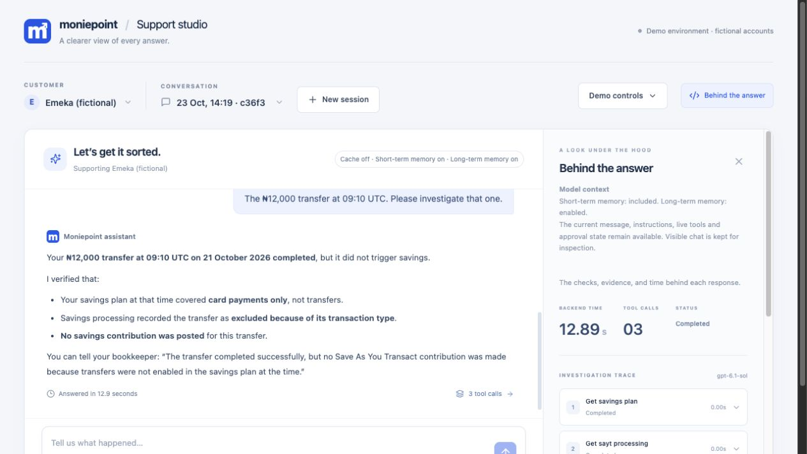
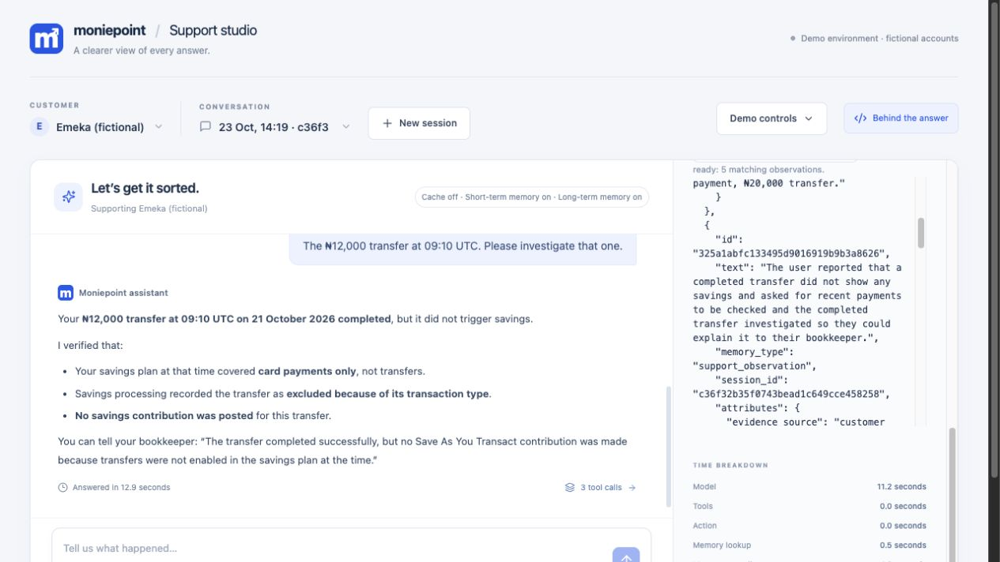
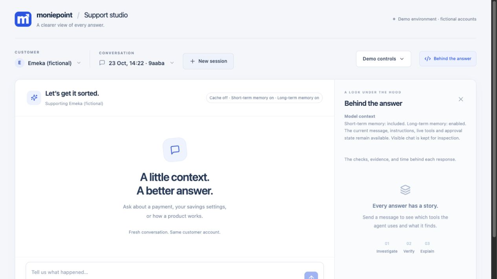
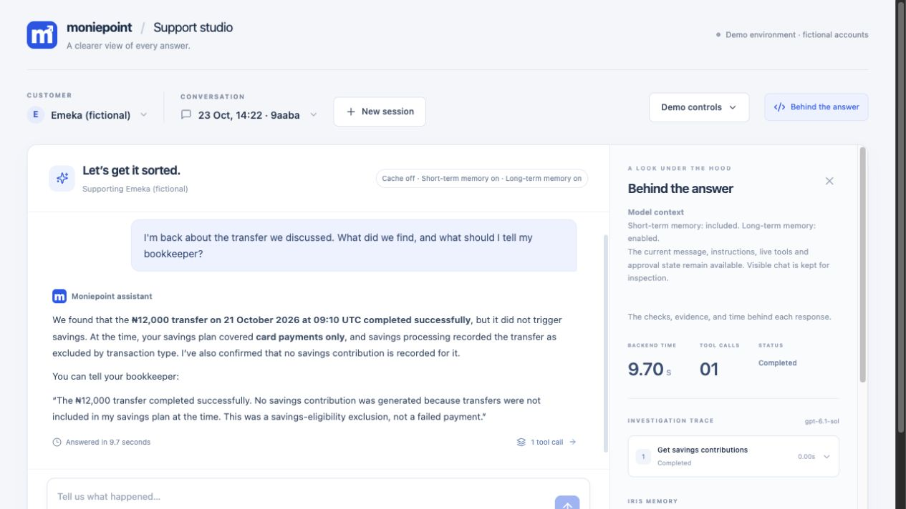
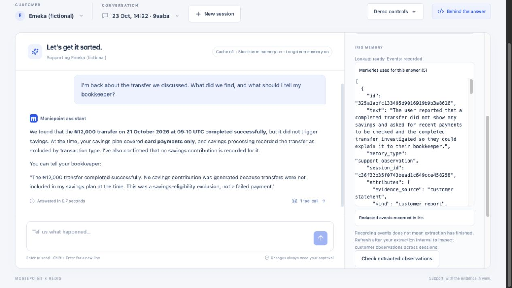
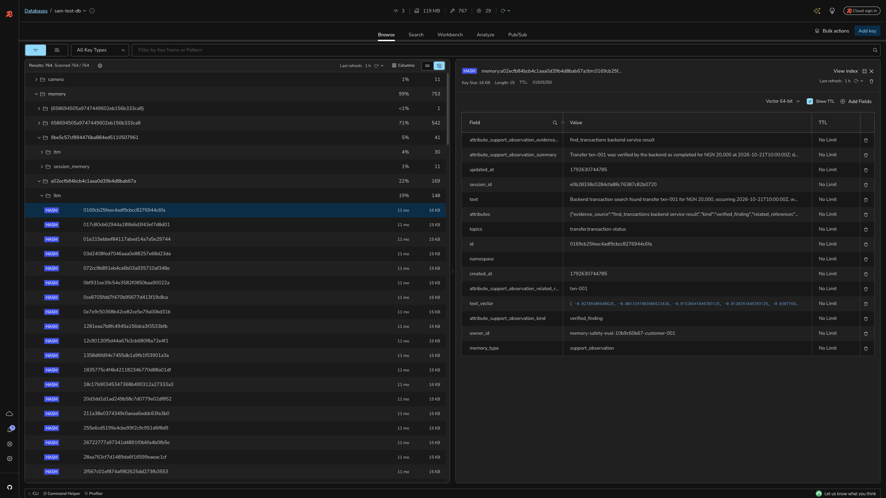

# A visual walkthrough of Support studio

This guide follows the real browser app, using fictional customers and payments.
The screenshots were captured on 23 October 2026. Replies, timings, and account
settings can differ in your run. No real money moves.

[Back to the README](../README.md) · [Setup instructions](../README.md#run-it-on-your-computer)

## Choose your path

**Presenting to a customer or business audience?** Use the 15-minute story below.
Keep **Behind the answer** closed until you want to explain a result. Lead with
what changes for the customer, then show the evidence if someone asks.

**Exploring the architecture?** Follow the numbered sections for exact prompts,
settings, and screenshots. Open **Behind the answer** to inspect tool calls,
extracted observations, and timing. Redis Insight is an optional deeper look.

## A 15-minute presenter story

Open with:

> A customer should not have to explain the same support issue every time they
> return. We will investigate a missing savings contribution, let the customer
> leave, and start a separate conversation to see what the assistant can carry
> forward. We will also show what it must check again.

### Before you present

Start the services and check that the model, Iris, and cache verifier are
available for the parts you plan to show. Choose a fictional customer and inspect
their current plan, recent payments, and existing memories. Earlier runs may
have changed the account. A new session does not reset it.

Use the same customer for both visits. Have the screenshots below available if
an external service is slow. If you use a previously extracted memory, say so.
Do not describe it as something just created during the demonstration.

### 0:00–2:00: establish what the assistant receives

Use the [short-term memory example](#3-demonstrate-short-term-memory), with
long-term memory and cache off. Send the reference word, then ask it to recall it.

**Say:** “The model needs us to supply relevant context. Within this conversation,
we can include earlier messages. Starting a new conversation changes that.”

**Look for:** correct recall with history on. The controls and context panel
explain which information was supplied. This is a context demonstration, not a
test of whether the model can infer a customer's name from account records.

### 2:00–6:00: investigate the first visit

Follow [Session A](#session-a-the-customer-raises-the-issue), with both memories
on and cache off. Let the agent identify the payment, clarify ambiguity, and
check the services.

**Say:** “A completed payment and a savings contribution are different things.
The assistant has to establish what happened, not just produce a plausible reply.”

**Look for:** a specific payment, evidence for the explanation, and a distinction
between the plan at the time and any current settings. Do not promise the same
number or order of tool calls on every run.

If you want to show an action, use the [approval example](#5-review-a-change-before-it-happens)
as a separate vignette. **Say:** “The assistant can propose a change. The customer
must authorize that specific proposal, and the application checks it.” Keep this
optional so it does not obscure the two-visit story.

### 6:00–9:00: make the break visible

Stop the first conversation. **Say:** “The customer has left. Recording this
conversation is not the same as having a useful long-term memory ready.”

Check extraction status. While it runs, demonstrate the
[semantic cache](#6-reuse-a-checked-policy-answer) in a separate session with
both memories off, or explain the evidence panel.

**Say:** “For suitable general questions, we can reuse a checked policy answer.
That is different from remembering this customer's support issue.”

**Look for:** the actual answer source and both policy-tool and overall response
time. A cache hit does not remove all model calls from the support agent.

Before returning to the customer story, identify a newly extracted observation
whose source session matches the first visit. If it is not ready, explain the
wait rather than pretending extraction has completed.

### 9:00–13:00: continue in a new conversation

Return to the same customer and follow
[Session B](#session-b-return-without-repeating-the-details). Click **New session**
and point out the empty chat and different session identifier. Ask the follow-up
without repeating the amount, transaction ID, or earlier diagnosis.

**Say:** “This is a new conversation. The customer wants to continue the issue,
not start the investigation from scratch.”

**Look for:** relevant memories from Session A in the recall evidence, an answer
that continues the issue, and live checks where current facts are needed.

**Say:** “Memory supplies continuity. It does not make an old claim true forever,
and it cannot authorize an account change.”

Show Redis Insight only if the audience wants to see the stored observation,
its customer scope, and the session it came from. Reading vectors or identifiers
aloud is not necessary to tell the customer story.

### 13:00–15:00: discuss value and limits

**Say:** “We have demonstrated continuity across conversations and selective reuse
of policy answers. The next question is whether that improves support outcomes.”

The benefits to evaluate are less repeated explanation, fewer unnecessary checks,
and shorter time to a correct resolution. This demo does not establish those
benefits as measured results. Compare memory on and off across the same support
scenarios, measuring correctness, time to resolution, repeated questions, and
unnecessary or incorrect actions. Keep correctness as a condition for success.

## If the live demo behaves differently

| What happens | What to do and say |
| --- | --- |
| Extraction is still pending | Explain that recording and extraction are separate. Show the cache example while waiting, then check again. Use a labelled previous run if time runs out. |
| The follow-up does not recall the issue | Check the customer, active session's long-term memory setting, extraction result, and recalled observations. A stored memory is not proof that this query retrieved it. |
| Several transactions match | Let the assistant ask which one. Clarification is useful when the records are genuinely ambiguous. |
| The account already has the proposed setting | Explain the current state and skip the change. Do not force an unnecessary proposal to match a script. |
| A paraphrase misses the cache | Show the verdict. Similar wording is not sufficient if the stored answer does not safely answer the new question. |
| A service is slow or unavailable | Show the recorded screenshots and identify them as a previous run. Do not present old timings as live measurements. |

## 1. Find your way around

Open http://127.0.0.1:5173/ after starting the services. Choose a customer on the
left. **New session** starts a conversation for that customer. **Behind the
answer** opens the explanation panel on the right.

The customer selector changes whose records the assistant can inspect. It is a
demo control, not a login system. This walkthrough uses Ada, Chidi, and Emeka. Existing sessions and memories
may be present if someone has already tried the demo.

## 2. Choose what the assistant receives

Open **Demo controls** to find the three switches:

- **Short-term memory:** include messages from this conversation.
- **Long-term memory:** recall and record observations for this customer through Iris.
- **Semantic cache:** allow reuse of checked product-guidance answers.

Set the switches first, then click **New session**. The badges above the chat
show the settings for the active session. Closing the controls keeps the screen
clear while you present.

## 3. Demonstrate short-term memory

Use short-term memory **on**, long-term memory **off**, and cache **off**.
Send these messages separately:

> For this demonstration, my reference word is BLUEBIRD. Please acknowledge it.

> What reference word did I just give you?

In this run the assistant replied **BLUEBIRD**, with no tool calls. The panel
explains that conversation history is included and long-term memory is excluded.
The time beneath the answer is the browser's measured wait.

For the comparison, turn both memories and the cache **off**, start a new session,
and repeat both prompts. The first message still appears in the chat, but it is
not sent back to the model with the second request. Visible chat and model context
are different things. Starting another session with only short-term memory on
also does not give it the previous session's conversation.

## 4. Investigate an earlier support issue

This sequence makes the session boundary visible. Use **Emeka**, enable both
memories, turn cache off, and click **New session**. The captured first session
is `c36f32b35f0743bead1c649cce458258` (shown as `c36f3` in the selector).
Emeka already had some older observations, so the proof below is the new memory's
originating session, not a claim that his entire memory store was empty.

### Session A: the customer raises the issue

Send:

> My transfer completed but I cannot see any savings. Please check my recent payments and investigate the completed transfer. I need to explain what happened to my bookkeeper when I return.

The assistant found two completed transfers and asked which one. Reply:

> The ₦12,000 transfer at 09:10 UTC. Please investigate that one.

In this run, service checks established that the transfer completed, the plan at
the time covered card payments only, processing excluded the transfer, and no
savings contribution was posted. The assistant gave an explanation for the
customer's bookkeeper. No plan change was requested or applied in this sequence.

### The break: let a new observation become available

Stop sending messages. The customer has left the conversation. Open **Behind the
answer** and click **Check extracted observations** after the extraction interval.
Recording events and extracting memories are separate steps; do not move on just
because the response says that events were recorded.

Look for an observation with Session A's `session_id`. In this run, the new
customer-report memory was `325a1abfc133495d9016919b9b3a8626`. It captured the missing
savings report and the request for an explanation for the bookkeeper. This is a
reported concern, not a verified financial fact. Verified service findings can
be extracted as separate observations. A second new memory,
`8ff6743709ae4d4ab4eac5f7f7f6d2da`, records the verified finding about the
₦12,000 transfer and names `emeka-transfer-001` as its related reference.
Both observations identify Session A as their source.

### Session B: return without repeating the details

Click **New session** for Emeka. Do not select the previous conversation from the
history menu. The empty chat and different session suffix establish the break:
Session A was `c36f3`; Session B is `9aaba`.

Send this as the first message in the new session:

> I'm back about the transfer we discussed. What did we find, and what should I tell my bookkeeper?

This message does not repeat the amount, time, transaction ID, or cause of the
problem. Short-term memory has no earlier messages in this session to supply
those details. Look for the newly extracted Session A observations under
**Memories used for this answer**, then inspect any live service checks.

In the captured return visit, the assistant identified the ₦12,000 transfer,
explained the earlier exclusion, and gave the bookkeeper explanation. It also
called **Get savings contributions** to check the ledger again.

The memory panel contains the new customer report and verified findings from
Session A. Match the memory ID and originating `session_id`; the number of
retrieved memories alone does not prove continuity. This is the full sequence:
first conversation, background extraction, a separate conversation, then recall.

For a comparison, start another session with long-term memory off and ask the
same return question. The assistant may inspect live records, but should not
claim access to an earlier conversation that was not supplied.

### Inspect the stored memory in Redis Insight

Redis Insight lets you inspect the database behind the memory service. Connect
to the database used by your Iris memory store, rather than assuming the local
application database also holds Iris memories.

This is **the same newly extracted memory** shown in the app screenshots above:
`325a1abfc133495d9016919b9b3a8626`. Its `session_id` points to Session A
(`c36f32b35f0743bead1c649cce458258`), and its `owner_id` is
`moniepoint-demo-customer-004`, Emeka's scope. Its kind is `customer_report`,
with `customer statement` as the evidence source. These matching identifiers
connect the first conversation, the stored record, and its recall in Session B.

The fields worth pointing out are:

| Field | What it tells you |
| --- | --- |
| `text` | The observation the agent can retrieve. |
| `memory_type` | Its category, here `support_observation`. |
| `session_id` | The conversation that produced it. |
| `owner_id` | The customer scope used to filter recall. |
| `attributes` | Evidence source, observation kind, and related references. |
| `created_at` | When the stored record was created. |
| `text_vector` | The numeric representation used for similarity search. |

To inspect the exact observation from this run, filter the key browser by
`*325a1abfc133495d9016919b9b3a8626*` and open the matching key. Confirm its
`session_id` is `c36f32b35f0743bead1c649cce458258`. For your own run, copy the memory
ID from the app instead. Key names and record identifiers vary by installation.
Use this view to explain the evidence, not to manually insert a memory for the
follow-up demonstration.

## 5. Review a change before it happens

This example uses Chidi with long-term memory and cache off. His plan initially
included card payments and transfers. Send:

> Please add airtime payments to my savings plan. Keep all my existing transaction types and savings amount unchanged.

The card compares the existing settings with the proposed settings. The assistant
has prepared a change, but it has not applied it. **Approve change** authorizes the
specific proposal; **Decline** leaves the plan unchanged. The backend checks the
approval before applying an update. A sentence generated by the model is not
permission to change an account.

We chose **Decline** after capturing this screenshot, so Chidi's plan was left
unchanged. If airtime is already enabled in your run, choose a transaction type
that is not currently enabled instead.

## 6. Reuse a checked policy answer

Set both memories **off**, turn semantic cache **on**, and start a new session.
Ask a general product question rather than a question about a personal payment:

> What is Save As You Transact and how does it work?

The first request may retrieve policy documents and generate an answer. If the
answer is suitable for reuse and passes the service's checks, it can be stored
in the background. Send the same question again after the first response has
finished. You can also try a paraphrase:

> How does Save As You Transact put money aside when I make payments?

Open **Behind the answer**, expand **Ask policy question**, and inspect the result.
A similar question is only a candidate for reuse. The verifier must accept it,
and the supporting policy versions must still be valid. A rejected match falls
back to retrieval and generation, so not every paraphrase produces a cache hit.

The repeated question in this run produced a verified cache hit. The policy tool
took about **0.64 seconds**, compared with **3.62 seconds** on the preceding
request. The complete support response took **8.7 seconds**, compared with
**10.4 seconds** before. These are individual observations, not a benchmark.

The distinction matters: the support agent still uses the model to decide which
tool to call and to compose the final reply. Caching the policy answer does not
remove every model call from the conversation.

For a comparison without caching, turn semantic cache **off**, start another
session, and ask the same question. Compare both the tool duration and the time
beneath the final answer. Cache off bypasses reuse and storage for that session;
it does not erase existing cache entries.

## Things to try yourself

These are experiments to explore, not scripted replies. Set the switches before
starting each session, send each quoted message separately, and use **Behind the
answer** to check what information the assistant actually used.

### Remember a name within the conversation

Turn short-term memory **on**, long-term memory **off**, and cache **off**. Use a
made-up name that is different from the selected customer's account name:

> Please call me Captain Mango during this conversation.

> What did I ask you to call me?

The assistant should use the name from the conversation. Repeat in a fresh
session with both memories off to see the difference. Asking for the selected
customer's account name would be a weaker test because account information can
come from the backend, even when conversation memory is off.

This tests conversational recall. It does not rename the account or demonstrate
that personal names are retained in long-term memory after PII filtering.

### Follow up without repeating the transaction details

Choose Ada. Turn short-term memory **on**, long-term memory **off**, and cache
**off**:

> Please show my recent completed payments.

Choose a payment from the returned list, for example:

> The ₦12,000 transfer. Why didn't that one generate savings?

> Would the same kind of payment generate savings under my current plan?

Watch whether the assistant follows the reference to "that one" and separates
historical processing from current settings. It should check the transaction,
processing outcome, savings contributions, and relevant plan details. If several
payments match, it should clarify which one you mean.

### Return to a transaction in a new conversation

Choose Ada, enable both memories, and leave cache off. Start with:

> My ₦12,000 transfer did not generate savings. Please investigate it.

After the investigation, use **Check extracted observations** and wait until a
relevant observation appears. Extraction happens in the background; a completed
reply does not mean a memory is ready yet.

Start a new session for the same customer with long-term memory on, then ask:

> We spoke about missing savings on a transfer earlier. What did we find, and is there anything left to do?

Inspect **Memories used for this answer**. The useful outcome is continuity
without asking the customer to repeat everything. The assistant should still
verify current account facts before recommending a change. Compare with a new
session with long-term memory off: it may investigate again using live records,
but it should not claim to remember a conversation it was not given.

### Correct something you said earlier

Turn short-term memory **on**, long-term memory **off**, and cache **off**:

> I think the payment I mean was ₦20,000.

> Sorry, I meant the ₦12,000 transfer. Please investigate that one instead.

> Which payment are we discussing now?

Look for the corrected amount and transaction, rather than the first guess.
Remembering a statement should not make it permanently true.

### Try a similar question with a different meaning

Turn both memories **off**, turn cache **on**, and start a new session:

> What is Save As You Transact and how does it work?

> Does every transfer automatically generate savings, even if transfers are not enabled in my plan?

The second question shares vocabulary with the first but asks about a specific
condition. Check the cache verdict and policy evidence. The system should only
reuse an answer if it actually addresses that condition; similarity alone is
not enough. A cache miss is a useful result when it avoids a misleading answer.

## What to explain as you present

- **Short-term memory** helps within the current conversation.
- **Long-term memory** brings useful observations into a later conversation.
- **Live services** establish account facts and carry out approved changes.
- **Policy retrieval** finds relevant product guidance.
- **Semantic caching** reuses eligible guidance after verification.
- **Behind the answer** makes the evidence and timing visible.

A new session clears the conversation context, not the customer's account or
stored memories. Use the switches and the evidence panel to show exactly which
information was available for each response.
