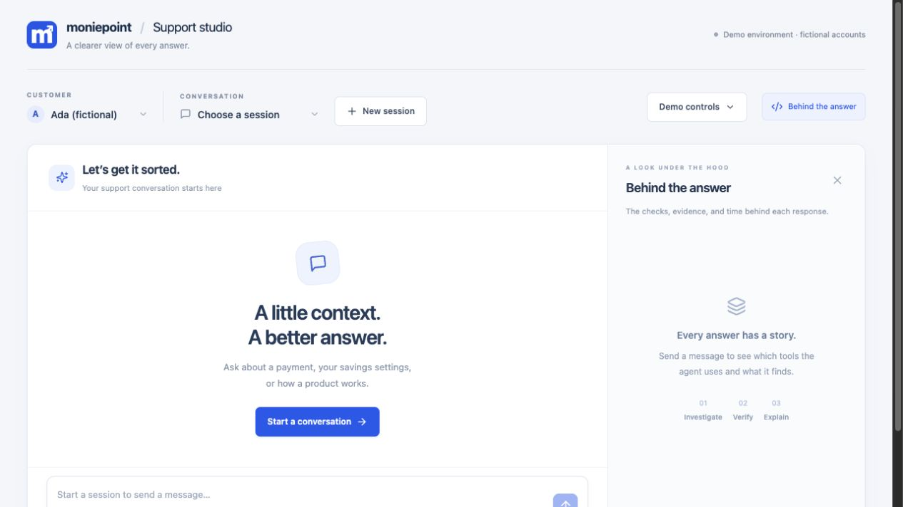
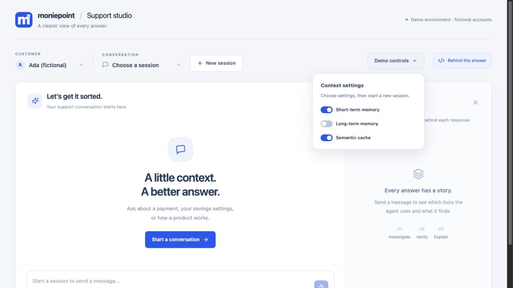
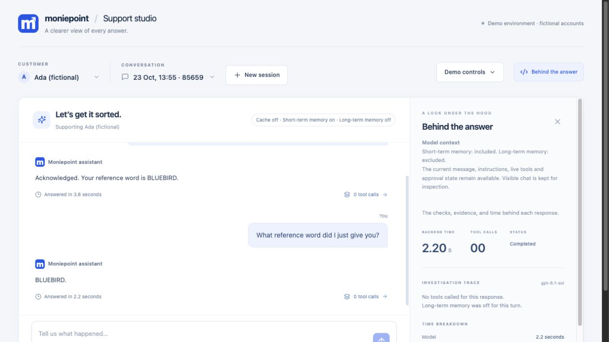
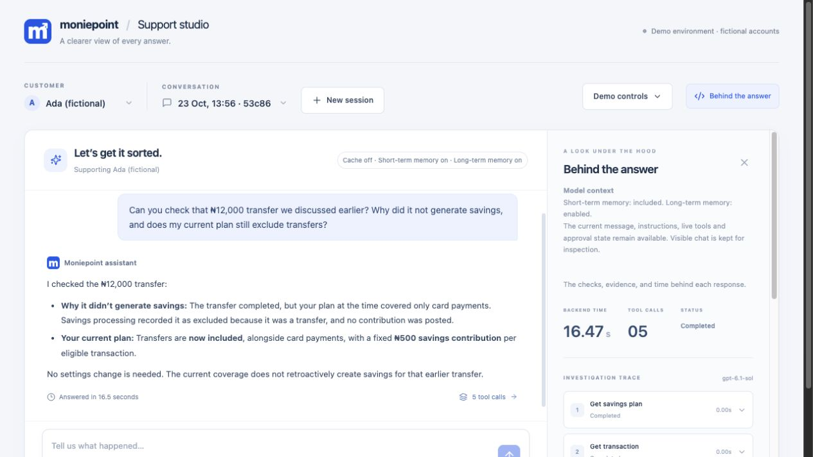
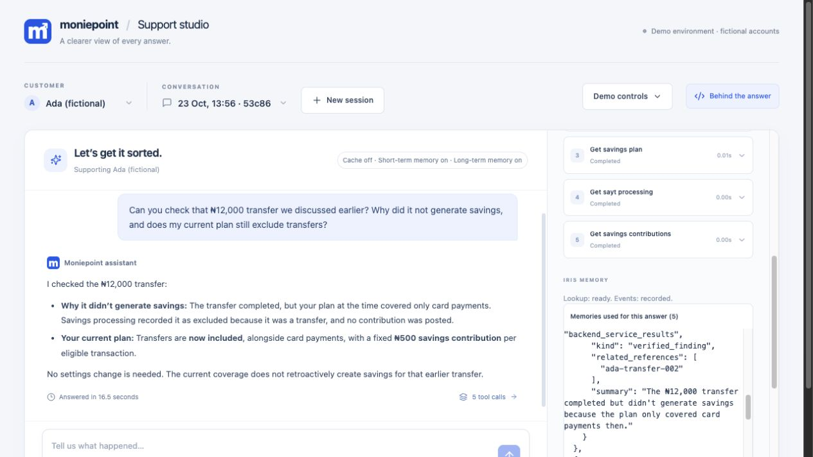
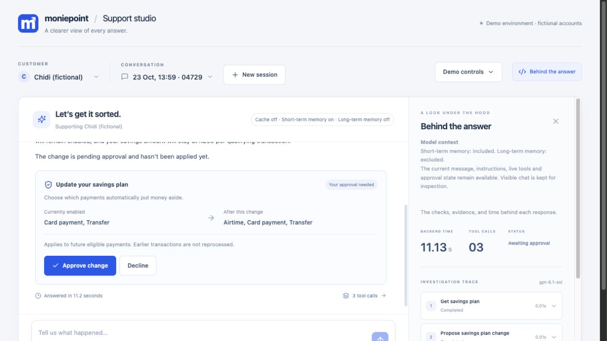
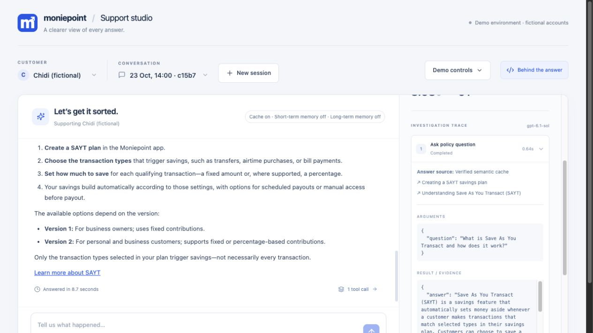

# A visual walkthrough of Support studio

This guide follows the real browser app, using fictional customers and payments.
The screenshots were captured on 23 October 2026. Replies, timings, and account
settings can differ in your run. No real money moves.

[Back to the README](../README.md) · [Setup instructions](../README.md#run-it-on-your-computer)

## 1. Find your way around

Open http://127.0.0.1:5173/ after starting the services. Choose a customer on the
left. **New session** starts a conversation for that customer. **Behind the
answer** opens the explanation panel on the right.

The customer selector changes whose records the assistant can inspect. It is a
demo control, not a login system. This walkthrough uses Ada and Chidi, leaving the two newer
customers available for fresh demonstrations.

## 2. Choose what the assistant receives

Open **Demo controls** to find the three switches:

- **Short-term memory:** include messages from this conversation.
- **Long-term memory:** recall and record observations for this customer through Iris.
- **Semantic cache:** allow reuse of checked product-guidance answers.

Set the switches first, then click **New session**. The badges above the chat
show the settings for the active session. Closing the controls keeps the screen
clear while you present.

## 3. Demonstrate short-term memory

Use short-term memory **on**, long-term memory **off**, and cache **off**.
Send these messages separately:

> For this demonstration, my reference word is BLUEBIRD. Please acknowledge it.

> What reference word did I just give you?

In this run the assistant replied **BLUEBIRD**, with no tool calls. The panel
explains that conversation history is included and long-term memory is excluded.
The time beneath the answer is the browser's measured wait.

For the comparison, turn both memories and the cache **off**, start a new session,
and repeat both prompts. The first message still appears in the chat, but it is
not sent back to the model with the second request. Visible chat and model context
are different things. Starting another session with only short-term memory on
also does not give it the previous session's conversation.

## 4. Investigate an earlier support issue

For a customer who already has extracted observations, enable both memories and
leave cache off. Start a new session. This is the prompt used for Ada:

> Can you check that ₦12,000 transfer we discussed earlier? Why did it not generate savings, and does my current plan still exclude transfers?

A new installation will not have Ada's earlier memories. First investigate a
payment with long-term memory enabled, wait for extraction, and check that an
observation is available before trying the return visit.

The assistant should distinguish the plan at the time of the transfer from the
plan now. Retrieved memories guide the investigation; service results establish
current facts. Expand a tool in **Behind the answer** to inspect its evidence.

In this captured run, the earlier transfer was excluded, but the current plan
already included transfers. The assistant checked five service results and did
not propose an unnecessary change.

**Memories used for this answer** lets you inspect the observations that informed
the response. **Redacted events recorded in Iris** shows what was sent for later
extraction. Recording and extraction are separate stages, so a new observation
may not be available immediately.

## 5. Review a change before it happens

This example uses Chidi with long-term memory and cache off. His plan initially
included card payments and transfers. Send:

> Please add airtime payments to my savings plan. Keep all my existing transaction types and savings amount unchanged.

The card compares the existing settings with the proposed settings. The assistant
has prepared a change, but it has not applied it. **Approve change** authorizes the
specific proposal; **Decline** leaves the plan unchanged. The backend checks the
approval before applying an update. A sentence generated by the model is not
permission to change an account.

We chose **Decline** after capturing this screenshot, so Chidi's plan was left
unchanged. If airtime is already enabled in your run, choose a transaction type
that is not currently enabled instead.

## 6. Reuse a checked policy answer

Set both memories **off**, turn semantic cache **on**, and start a new session.
Ask a general product question rather than a question about a personal payment:

> What is Save As You Transact and how does it work?

The first request may retrieve policy documents and generate an answer. If the
answer is suitable for reuse and passes the service's checks, it can be stored
in the background. Send the same question again after the first response has
finished. You can also try a paraphrase:

> How does Save As You Transact put money aside when I make payments?

Open **Behind the answer**, expand **Ask policy question**, and inspect the result.
A similar question is only a candidate for reuse. The verifier must accept it,
and the supporting policy versions must still be valid. A rejected match falls
back to retrieval and generation, so not every paraphrase produces a cache hit.

The repeated question in this run produced a verified cache hit. The policy tool
took about **0.64 seconds**, compared with **3.62 seconds** on the preceding
request. The complete support response took **8.7 seconds**, compared with
**10.4 seconds** before. These are individual observations, not a benchmark.

The distinction matters: the support agent still uses the model to decide which
tool to call and to compose the final reply. Caching the policy answer does not
remove every model call from the conversation.

For a comparison without caching, turn semantic cache **off**, start another
session, and ask the same question. Compare both the tool duration and the time
beneath the final answer. Cache off bypasses reuse and storage for that session;
it does not erase existing cache entries.

## What to explain as you present

- **Short-term memory** helps within the current conversation.
- **Long-term memory** brings useful observations into a later conversation.
- **Live services** establish account facts and carry out approved changes.
- **Policy retrieval** finds relevant product guidance.
- **Semantic caching** reuses eligible guidance after verification.
- **Behind the answer** makes the evidence and timing visible.

A new session clears the conversation context, not the customer's account or
stored memories. Use the switches and the evidence panel to show exactly which
information was available for each response.
